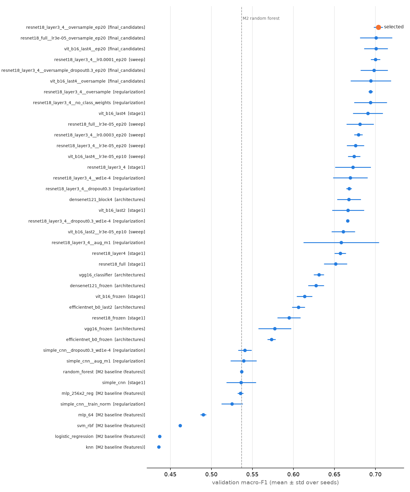
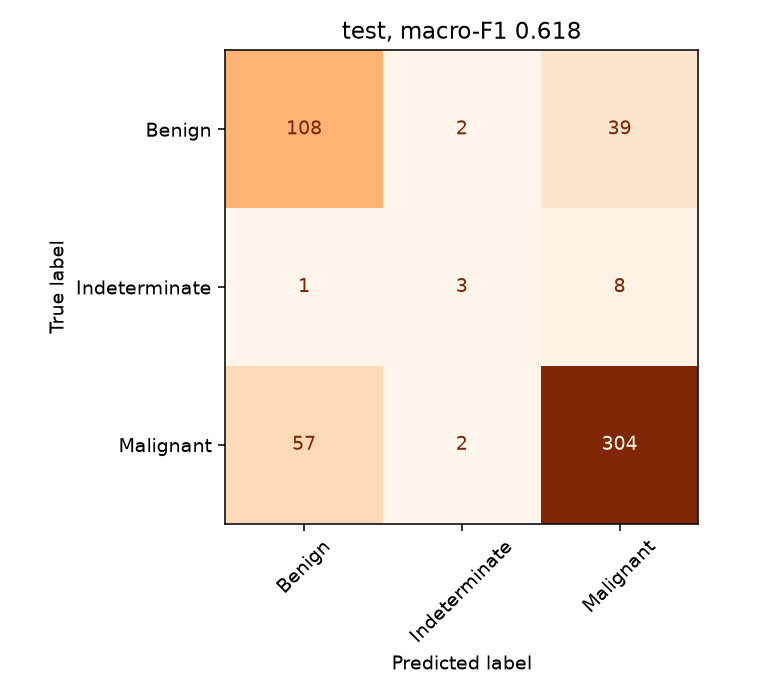
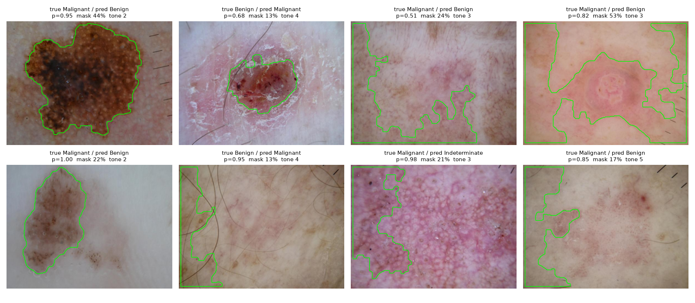
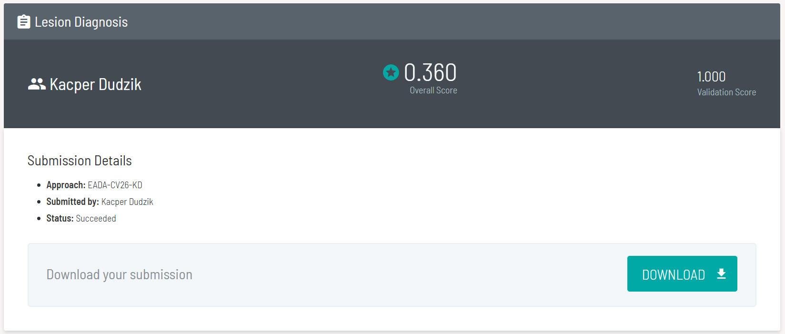

# MILK10k lesion classification: final report

Computer Vision and Speech Recognition, EADA, individual project. Approach name on the
official leaderboard: `EADA-CV26-KD`.

Everything below is reproducible from [README.md](README.md). Every number comes from a file
in `outputs/` or `runs/`; every model was trained on the same split and scored with the same metric.

## 1. Problem and data

**Clinical question.** Given the dermoscopic image of a skin lesion suspected of being a
malignant neoplasm, predict its diagnosis: three classes for the analysis (`diagnosis_1`:
Benign, Indeterminate, Malignant) and eleven classes for the official leaderboard (AKIEC, BCC,
BEN_OTH, BKL, DF, INF, MAL_OTH, MEL, NV, SCCKA, VASC).

**Data.** MILK10k: 5,240 lesions, each with one dermoscopic and one clinical close-up image
(10,480 images). The input here is the dermoscopic image only (one image per lesion), as in
class. 5,016 lesions are confirmed by histopathology, 224 by a single clinician.

**Imbalance and selection bias.** 69% of lesions are malignant, 28% benign, 2% indeterminate.
In 11 classes, BCC alone is 48% and MAL_OTH has 9 lesions in the whole set. The archive is
biopsy-enriched: malignant is the majority here but the minority in a screening clinic. Accuracy
therefore misleads; the metric is **macro-F1** (every class counts equally), plus the official
leaderboard F1 (each probability ≥ 0.5 counts as "yes", F1 per class, mean of classes).

## 2. Splits

Lesion-level `StratifiedGroupKFold` (10 folds, seed 0, stratified on `diagnosis_1`): fold 0 =
test, folds 1–2 = validation, folds 3–9 = train. This is the Session 7 split.

| Split | Lesions | Malignant / Benign / Indeterminate |
|---|---|---|
| train | 3,668 | 69.4% / 28.3% / 2.3% |
| validation | 1,048 | 69.3% / 28.3% / 2.4% |
| test | 524 | 69.3% / 28.4% / 2.3% |

**No leakage, by construction and checked in code** (`check_project.py`): one image per lesion,
no lesion in two splits, the split frozen in `splits/*.csv` and reused by every model; the
ImageNet mean/std (pretrained networks) is fixed, and the training-set statistics used for the
from-scratch variant are computed on train only; the test split is scored once
(`evaluate.py --test` refuses to run twice); the official ISIC test lesions share no lesion with
MILK10k training data.

## 3. Models and scoreboard

**Target for the comparison: 3 classes (`diagnosis_1`), Path A.** 40 experiments × 3 seeds =
120 runs (plus 3 for the 11-class model), about 4 GPU-hours on an RTX 5070 Laptop. All deep
models share one training loop (Session 6/7 `fit`): Adam, cross-entropy, random flips, batch 64,
and the epoch with the best validation macro-F1 is kept (early stopping). Stages:

1. **Course models**: random forest on 33 Session 5 features (plus logistic regression, kNN,
   SVM and two Session 6 MLPs), SimpleCNN from scratch, ResNet-18 and ViT-B/16 frozen and
   partially fine-tuned.
2. **Learning rate and epochs**: lr 3e-5 / 1e-4 / 3e-4, 10 vs 20 epochs.
3. **More architectures** (S7 slide 18 and homework: VGG-16, DenseNet-121, EfficientNet-B0) and
   **regularisation, one factor at a time** (S6 slide 32, S3): dropout 0.3, weight decay 1e-4,
   stronger augmentation (rotation 15°, brightness/contrast/saturation 0.1), oversampling vs
   class weights, train-set normalisation.
4. **Final candidates**: only the changes that helped, combined on the two best architectures.

Key rows (macro-F1, mean ± std over 3 seeds; full table with all 40 experiments in
[outputs/diagnosis_1/scoreboard.md](outputs/diagnosis_1/scoreboard.md)):

| Model | Val macro-F1 | Test macro-F1 |
|---|---|---|
| Random forest, 33 S5 features (M2) | 0.537 ± 0.001 | 0.511 ± 0.023 |
| CNN from scratch (M3) | 0.536 ± 0.018 | 0.540 ± 0.011 |
| ResNet-18 frozen + new head (M3) | 0.595 ± 0.014 | 0.580 ± 0.026 |
| ResNet-18 fine-tune layer4 (M3, S7 best) | 0.657 ± 0.007 | 0.583 ± 0.023 |
| ViT-B/16 frozen + new head (M4) | 0.614 ± 0.009 | 0.589 ± 0.021 |
| ViT-B/16 fine-tune last 4 blocks (M4) | 0.691 ± 0.018 | 0.595 ± 0.039 |
| DenseNet-121 fine-tune last block | 0.668 ± 0.015 | 0.578 ± 0.014 |
| ResNet-18 layer3+4, oversampling, 20 epochs (selected recipe) | **0.704 ± 0.006** | 0.584 ± 0.037 |
| **Best → final: the selected recipe, seed 2** | **0.710** | **0.618** |

## 4. Best model

**ResNet-18 (ImageNet), layer3 + layer4 + new `fc` trained (10.5 M of 11.2 M weights),
lr 1e-4, 20 epochs, oversampling of rare classes instead of loss weights.** Chosen because it
has the highest mean validation macro-F1 of all 40 experiments, with one of the smallest seed
spreads.

What moved it from the Session 7 recipe (0.673 ± 0.022 on validation):

- **20 instead of 10 epochs: +0.027.** The kept epoch was 12–18, so 10 epochs stopped too early.
- **Oversampling instead of class weights: +0.021, seven times smaller spread.** The class
  weight of 14 for Indeterminate made training unstable (the caution on S3 slide 34).
- **No measurable effect:** dropout 0.3, weight decay 1e-4, stronger augmentation, train-set
  normalisation. Dropout made seeds more consistent but not better.
- **Architecture:** ViT-B/16 (last 4 blocks) reached the same level (0.691 → 0.700 with 20
  epochs) at 12 times the training cost. DenseNet-121 was the best *frozen* backbone (0.628);
  VGG-16 and EfficientNet-B0 stayed lower.

**Honest reading of the test column.** Across all 40 experiments the validation ranking
predicts the test ranking (Spearman 0.70): features < from-scratch CNN < frozen pretrained <
fine-tuned pretrained. Among the ten best models it does not (Spearman −0.07): they all score
0.57–0.61 on test, within their seed spread. The 0.09 drop of the winner from validation to test
is the expected optimism of choosing the maximum of 40 noisy validation scores, made larger by a
small test split (12 Indeterminate lesions). The model was **not** re-chosen on test.

## 5. Error analysis and fairness

Test split, final 3-class model ([outputs/diagnosis_1/analysis/](outputs/diagnosis_1/analysis/)):

| Class | Precision | Recall | F1 | Lesions |
|---|---|---|---|---|
| Benign | 0.65 | 0.73 | 0.69 | 149 |
| Indeterminate | 0.43 | 0.25 | 0.32 | 12 |
| Malignant | 0.87 | 0.84 | 0.85 | 363 |

- **57 of 363 malignant lesions (16%) are called benign**: the clinically costly error.
- **By fine diagnosis** (`errors_by_dx11.csv`): BCC, the dominant class, is wrong 7.5% of the
  time, but **melanoma 51% (21 of 41)**, AKIEC 44%, BKL 40%, and the rare benign types
  DF / INF / BEN_OTH 63–67%. The model has learned the common class, not the rare ones.
- **What the misclassified images share** (`misclassified.png`, with the Session 8
  darkness + Otsu mask): most are pale, pink, non-pigmented lesions; on exactly these the
  classical mask fails and outlines the image corners instead of the lesion. Several errors are
  made with high confidence (p = 0.95–1.00). Lesion size does not explain errors: the mean mask
  area is 0.26 for wrong and 0.27 for correct answers.

*Eight misclassified test lesions (random sample of the errors). Title: true / predicted class,
the model's probability for its prediction, mask area, skin tone. Green: Session 8 darkness +
Otsu lesion mask.*

**Fairness** (`fairness.csv`, test split):

| Group | Lesions | Macro-F1 | Accuracy |
|---|---|---|---|
| Female | 217 | 0.61 | 0.77 |
| Male | 307 | 0.62 | 0.81 |
| Skin tone 1 | 9 | 0.64 | 0.67 (too small to compare) |
| Skin tone 2 | 49 | 0.50 | 0.74 |
| Skin tone 3 | 328 | 0.49 | 0.79 |
| Skin tone 4 | 95 | 0.75 | 0.80 |
| Skin tone 5 | 43 | 0.86 | 0.88 (only 2 classes present) |

No gap by sex. Accuracy is similar across skin tones (0.74–0.88); the macro-F1 differences are
driven by where the 12 Indeterminate lesions fall, so they are not evidence of a skin-tone bias,
and not evidence of its absence either. Skin tones 0–1 have 9 test lesions in total: the
data cannot answer the question for dark skin, which is the most important limitation.

## 6. Leaderboard

The selected recipe was retrained once with 11 outputs (`nn.Linear(512, 11)`, labels from
`training_gt.csv`, same split, 3 seeds); the seed with the best validation score was submitted.
Per-class thresholds were tuned on validation only and the probabilities rescaled so each
threshold sits at 0.5 (brief, slide 15; classes with fewer than 5 validation lesions keep 0.5).

| 11-class model | Raw probabilities | With validation thresholds (submitted) |
|---|---|---|
| Validation macro-F1 (argmax) | 0.467 | — |
| Validation leaderboard F1 | 0.447 | 0.495 (optimistic: tuned here) |
| **Held-out test leaderboard F1 (local estimate)** | 0.385 | **0.402** |
| **Official score (ISIC, 479 blind lesions, approach EADA-CV26-KD)** | — | **0.360** |

`submission/submission.csv`: 479 rows × 12 columns, dermoscopic image only, the validation
transform, all four format checks passed. The first column is named `lesion_id`: the ISIC
validator rejected a first upload whose column was named `lesion` (as on brief slide 14) with
"Missing column in CSV: image or lesion_id"; the predictions were unchanged.

**Is 0.40 good?** Against chance on the same test lesions: uniform probabilities score 0.000
(nothing reaches 0.5), always answering "BCC" 0.065, a random guess in proportion to class
frequency 0.099. The model is four times better than guessing. The score splits sharply by class
size: **0.568 on the six common classes** (AKIEC, BCC, BKL, MEL, NV, SCCKA; best BCC 0.86,
NV 0.71) and **0.153 on the four rare classes** in the test split (BEN_OTH, DF, INF, VASC; 31–38
training lesions each). Because the macro mean weights each class equally, these 21 rare test
lesions (4% of the split) cost about 0.17 points. Heavier class penalties would not fix this:
oversampling already presents every class equally often, and the per-class thresholds already
lower the bar for rare classes; with ~35 training examples per class the network cannot learn a
reliable boundary.

**Local estimate vs official score: 0.402 → 0.360, explained.** Our held-out test split
contains no MAL_OTH lesion, so its 0.402 is a mean over 10 classes. The official blind test set
scores all 11 classes, and the model has never predicted MAL_OTH correctly (7 training lesions;
validation F1 0). Counting MAL_OTH as 0 turns the local estimate into 0.402 × 10 / 11 = **0.365**,
within 0.005 of the official **0.360**. The remaining difference is well inside the
seed-to-seed spread of the 11-class model (test macro-F1 0.410 ± 0.019), so the honest local
test estimate predicted the official score; the validation numbers (0.45–0.50) were optimistic
for the reasons in section 4. On the official metric the model is 3.6 times better than a random
guess by class frequency (0.099 on our test split).

## 7. Model card and limits

Full card: [model_card.md](model_card.md). In short: the model is a course project for studying
honest evaluation on MILK10k. It is **not** a medical device, must **not** be used to decide
whether a lesion is biopsied, and must not be used on clinical close-up photographs, on skin
tones absent from training, or as a screening tool (the archive is biopsy-enriched). It misses
16% of malignant lesions and half of the melanomas in our test split.

## Appendix A. Reproduction details of the submitted model

| Item | Setting |
|---|---|
| Training data | MILK10k training set only (no external images); dermoscopic image of each lesion; labels from `training_gt.csv` (11 classes, argmax of the one-hot row) |
| Split | `StratifiedGroupKFold(n_splits=10, shuffle=True, random_state=0)` on dermoscopic rows, groups = `lesion_id`, stratified on `diagnosis_1`; fold 0 test (524), folds 1–2 validation (1,048), folds 3–9 train (3,668) |
| Preprocessing | PIL `convert("RGB").resize((224, 224))` (default resampling), `/255`, ImageNet mean (0.485, 0.456, 0.406), std (0.229, 0.224, 0.225); identical at training, validation and inference |
| Augmentation (training only) | independent random horizontal and vertical flips, p = 0.5 each |
| Network | torchvision ResNet-18, `IMAGENET1K_V1` weights; `fc` replaced by `nn.Linear(512, 11)`; parameters of `layer3`, `layer4`, `fc` trained, all others frozen (`requires_grad=False`) |
| Imbalance | sampling with replacement, probability ∝ 1 / class count (each epoch draws 3,668 training images); unweighted cross-entropy |
| Optimisation | Adam, lr 1e-4, no weight decay, batch 64, 20 epochs; model kept at the epoch with the best validation macro-F1 (epoch 9 for the submitted seed) |
| Seeds | 0, 1, 2; the seed with the best validation macro-F1 (0) is submitted |
| Thresholds | per class, grid 0.05–0.95 (step 0.05), chosen to maximise that class's F1 on validation; classes with < 5 validation lesions keep 0.5. Thresholds: AKIEC 0.55, BCC 0.20, BEN_OTH 0.15, BKL 0.25, DF 0.25, INF 0.25, MAL_OTH 0.50, MEL 0.35, NV 0.10, SCCKA 0.70, VASC 0.15 |
| Submission | dermoscopic image of each of the 479 test lesions; softmax probabilities rescaled per class with `p < t: 0.5·p/t`, else `0.5 + 0.5·(p − t)/(1 − t)` (monotone, threshold → 0.5, values in [0, 1]) |
| Model selection | the training recipe had the best mean validation macro-F1 of 34 image-network experiments × 3 seeds on the 3-class task (`diagnosis_1`); then retrained once with 11 outputs |
| Software and hardware | Python 3.14, PyTorch 2.14 (CUDA 13.0), torchvision 0.29, scikit-learn 1.9; one NVIDIA RTX 5070 Laptop GPU (8 GB); about 1 minute per training run |

## Data citation

- MILK study team. MILK10k Benchmark. ISIC Archive, 2025. doi:10.34970/262082
- Tschandl P, et al. MILK10k: A Hierarchical Multimodal Imaging-Learning Toolkit for Diagnosing
  Pigmented and Nonpigmented Skin Cancer and its Simulators. J Invest Dermatol.
  2026;146(2):357-364. doi:10.1016/j.jid.2025.06.1594
- Licence CC-BY-NC (non-commercial use only). Pretrained weights: ImageNet (torchvision) for
  ResNet-18, ViT-B/16, VGG-16, DenseNet-121, EfficientNet-B0.
